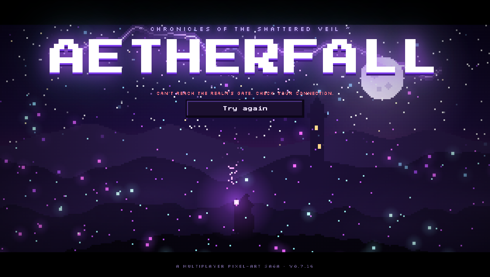

# AETHERFALL — offline mirror

Full mirror of **AETHERFALL** (https://aetherfall.dev/).

Source: https://aetherfall.dev/



> **Cover blocked (2026-10-12)** — AETHERFALL is a server-authoritative multiplayer
> MMO: gameplay runs against a live realm backend (AWS API gate + Convex + zone
> websocket) that is not capturable and whose gate CORS-locks its origin to
> `https://aetherfall.dev` (a localhost/mirror origin gets `403 "This page may not
> use the gate."`). Served from the mirror origin the client boots and renders its
> title screen (the image above is real boot evidence from this mirror), but it
> cannot pass the gate, so no gameplay screenshot from the mirror exists.
> `docs/cover.png` is intentionally **not fabricated** (PLAN §7 rejects menu/title
> shots as covers). Re-shoot the cover if the client ever gains an offline mode or a
> local gate; until then the boot evidence above is the mirror's visual.

## Stack

- **Vite production build at the origin root** — `index.html` + hashed `assets/*` chunks, no build step to serve
- **React 19.3.0** (`react` + `react-dom` + scheduler) bundled inside the entry chunk; **three.js r186** bundled inside the 3D renderer chunk, with a separate `GLTFLoader` addon chunk (DRACO / meshopt / KTX2 hooks)
- **two renderer chunks** — `assets/fx3d-*.js` (3D particle renderer, `createFx3D`) and `assets/hd2d-*.js` (2D/HD renderer, `createHd2d`), dynamic-imported by the client
- **Web Audio music** — four tracks fetched at runtime as `/audio/<name>.webm` with `.m4a` fallback
- **multiplayer client** — the bundle talks to an external AWS API gate and a zone websocket (see *External dependencies*); the mirror carries the client only

## What this is

AETHERFALL — "an epic pixel-art fantasy MMO RPG" (manifest.webmanifest), title screen *Chronicles of the Shattered Veil*, client version v0.7.16: a landscape-play pixel-art MMO with character creation (schools, elements, passives), an overworld (Marizon and beyond), quests, shops, loot and a 3D/HD-2D renderer switch, rendered by React + three.js from a Vite build. Captured whole from the origin root — entry document, four JS chunks, the stylesheet, every hashed sprite/art asset the bundle references, the parchment UI texture, both audio formats of all four tracks, favicon and web app manifest: **71 files, 16,423,492 bytes (~15.7 MiB)**, plus the runtime-built closure (dynamic imports, `__vite__mapDeps` tables, `/audio/…` names, CSS `url()` references) found by iterating the scan to a fixpoint.

**External dependencies (not captured, by design — CDN rule, socker precedent):** the AWS API gate `https://t5xbd6rn22.execute-api.sa-east-1.amazonaws.com` (guest auth, characters, `POST /v1/enter`, CORS-locked to the canonical origin), the Convex deployment the client syncs with (`docs.convex.dev` reference + Convex character plumbing inside the bundle), the zone websocket the gate hands out, Google Fonts (Press Start 2P / Silkscreen / Pixelify Sans / Atkinson Hyperlegible) and the Cloudflare Insights beacon. Without the backend the client renders and runs its title screen, but gameplay entry is refused.

**Capture gaps recorded honestly:** the deployment serves all **41 `.glb` model URLs as Git LFS pointer stubs** (131–132 bytes each — `version https://git-lfs.github.com/spec/v1 / oid sha256:… / size …`, `Content-Type: model/gltf-binary`); the real meshes were never deployed, so the mirror carries the stubs byte-exact as served. 136 unhashed logical asset keys extracted from the bundle (`assets/epic-0.png`, `assets/hall-storm.json`, `assets/marizon-cottage.glb`, …) are masked 404s: the origin's SPA fallback answers HTTP 200 with the entry HTML (the served artifacts are the hashed `/assets/…` files captured here, or objects inlined in the bundle) — they are recorded in `_mirror-report.json` under `unreachable` and in the scan, not silently dropped. Zero genuinely unreachable same-origin references remain.

## Layout

- `.upstream/manifest.json` — sha256 for every captured file (71 files)
- `readable/` — prettified derived layer (pinned prettier 3.9.6): the four minified
  chunks and the stylesheet (5 pretties, 233,892 lines)
- `src/` + `split-spec.json` — 339 statement-aligned slices of the app chunks with
  the recorded derivation spec (6 wholeFile sections, 3 skipped sections)
- `tools/derive.mjs` — rebuild `readable/` + `src/` + `split-spec.json`
- `tools/update.mjs` — read-only drift probe against the live site
- `tools/verify.mjs` — re-hash the capture against the manifest
- `tools/audit.js` — integrity gate for the derived layers (`AUDIT PASS`)
- `docs/boot-2026-10-12.png` — boot evidence (title screen rendered by this mirror)
- `_mirror-report.json` — crawl record (probes, closure, unreachable, external)

## Assets

- **sprites / 2D art** — 13 file(s): `assets/` (epic-0…4, ground-0, mana-0/1, raven, srw, holloway — the NPC/enemy/world sprite atlases; scenery.model_crystal-altar, scenery.model_hollowed-crystal — the two scenery sprite sheets)
- **UI texture** — 1 file(s): `assets/` (parchment-vwolfdog — the parchment `url()` texture used by the stylesheet)
- **3D models (Git LFS pointer stubs, as served)** — 41 file(s): `assets/` (aether-crystal, castle-tower-*, hall-*, marizon-*, town-*, frost-pine, glowcap-mushrooms, … — 131–132 B LFS pointers; see *Capture gaps*)
- **audio** — 8 file(s): `audio/music/` (marizon_fight, marizon_idle, title_theme — each `.webm` + `.m4a`), `audio/ui/` (start_chime — `.webm` + `.m4a`)
- **code bundles** — 5 file(s): `assets/` (index-BTsv3a2s.js, fx3d-DiRK8ozf.js, hd2d-FOjpdF4f.js, GLTFLoader-MfgfXc7d.js, index-CrHozmsT.css) — captured verbatim, never edited
- **UI/icon + web app metadata** — 2 file(s): `favicon.svg`, `manifest.webmanifest` (root)
- **fonts** — none on disk — Google Fonts stay a CDN dependency (external)

## Run

```
npx serve .
```

Open the served root in a browser. The client boots and renders; entering the world
needs the live realm backend (see *Cover blocked* / *External dependencies*). When
served from `localhost` the bundle allows a dev gate override — `?gate=https://…`
— and a zone override `?zone=off` / `?zone=<url>`, both by design of the shipped
client; neither substitutes for the missing backend.

## Verify

```
node tools/verify.mjs     # re-hash the capture against the manifest
node tools/audit.js       # derived-layer integrity gate
```

## Updating from upstream

```
node tools/update.mjs     # read-only drift probe: what changed upstream
```

The probe never rewrites the capture — a mirror is a point-in-time snapshot.
Notes for this origin: the entry is fetched with browser `Accept` headers (Cloudflare
only injects the Insights beacon into browser-shaped HTML requests — the capture was
taken that way) and the beacon tag is normalized on both sides; the origin has an SPA
fallback, so a 200 answer that is HTML on a non-HTML capture rel is reported as
`html-fallback (masked 404 upstream)`, never accepted. Refreshing means re-running the
fetch into a clean tree and re-cutting the derived layers on top of the new build.

### 2026-10-12 readable/src derivation

Both derived layers are in place, cut from the recorded capture (capture bytes
untouched — `node tools/verify.mjs` re-hashes all 71 files):

- `readable/` — pinned prettier 3.9.6 (module API, default options — never the CLI,
  it respects `.gitignore` and can silently echo its input) rendered the four
  minified chunks + the stylesheet to 5 pretties (233,892 lines total; capture-root
  names, dirs flattened with `__`). Every pretty is provably not a byte copy of its
  capture source. One nuance recorded in `split-spec.json`: prettier 3.9.6 needs a
  **second pass** on one member-chain region of the index chunk (pass 1 → pass 2
  differ, pass 2 is a fixed point), so derive and audit both iterate to the fixed
  point instead of claiming single-pass; audit re-renders all 5/5 pretties
  byte-exact under the pinned version.
- `src/` — 339 statement-aligned slices (`src/<tag>-NN.js`, exact 2-line provenance
  header) recorded in `split-spec.json` (348 sections): 339/339 parse standalone
  (`node --input-type=module --check -`) and round-trip byte-exact to their readable
  line ranges. Cuts land only on top-level declaration boundaries (~250–350 line
  windows); oversized single declarations stay whole (largest:
  `assets__index-BTsv3a2s-126.js`, 21,411 lines — the asset-URL map + a giant
  data-table declaration the minifier kept as one statement). Identification is the
  bundle's own minified names — the rename campaign (PLAN §5) remains an open task.
- Vendor rule — wholeFile sections, never sliced: the three.js `GLTFLoader` addon
  chunk (`assets/GLTFLoader-MfgfXc7d.js`, whole file) and the bundled three.js r186
  engine region inside `assets/fx3d-DiRK8ozf.js` (three.core/three.module up to and
  including the WebGLRenderer class; guarded by `WebGLRenderer`, `__THREE__ = '186'`
  and `revision: '186'`). The minifier merged the game's particle-shader table and
  element-palette tables into the same variable declaration as the WebGLRenderer
  class — declaration boundaries cannot cut inside it, so the wholeFile region
  carries them and the app resumes at the guarded palette color helper.
- Vendor region in the entry chunk — wholeFile, never sliced: the React 19.3.0
  bundle (react + react-dom + scheduler as CJS modules under the rollup require
  helper, one declaration), guarded by `react.dev/errors`, `Minified React error`,
  `react.transitional.element`, `createRoot`, version `19.3.0` and the DevTools
  hook; the app resumes at the guarded class-table head.
- Machinery rule — wholeFile: the `__vite__mapDeps` table + rollup CJS interop
  helpers + Vite modulepreload polyfill opening the index chunk, and the
  `__vite__mapDeps` table opening the hd2d chunk. Stylesheet rule —
  `assets/index-CrHozmsT.css` is wholeFile. Non-standalone parts are skipped
  sections (3): every app chunk's final `export {…}` table (the bindings live in the
  earlier slices).
- Inline scan — `index.html` has zero inline `<script>`/`<style>` content blocks
  (two external scripts: the entry chunk and the CF beacon), so there are no
  `*-inline-N` twins and no `index-inline-map.json`.
- Gates: `node tools/verify.mjs` → `71 files checked, 0 problems`;
  `node tools/update.mjs` → `up to date: 71 captured files identical upstream`;
  `node tools/audit.js` → `AUDIT PASS` (339/339 round-trips, 5/5 pretties re-render
  byte-exact, 348 sections, 6/6 imports resolve); serve probe — entry, the entry JS,
  the stylesheet, the fx3d chunk and an audio track over HTTP 200, listener killed,
  port closed (netstat + refused connection). Rebuild with `node tools/derive.mjs`.
- Boot test (opencli, default profile; mirror served on loopback with `npx serve`):
  the title screen renders — pixel-art scene, animated particles, zero console
  messages — screenshot `docs/boot-2026-10-12.png`. A full browser network log
  cross-checks the closure: 23 same-origin requests during boot (entry, entry
  JS/CSS, favicon, webmanifest, 12 sprite/art assets, 4 audio `.webm`), every one
  present in `.upstream/manifest.json`; the only same-origin miss is the Cloudflare
  Insights beacon's `/cdn-cgi/rum` telemetry (a static mirror has no CF edge —
  404, `cdn-cgi` class, never captured, probe-neutral). **Actual gameplay could not
  be reached from the mirror origin**: the client's first gate call
  (`POST /v1/guest` on the AWS API) fails CORS (`403 This page may not use the gate.`
  — the API's `access-control-allow-origin` is `https://aetherfall.dev` only), and
  the bundle's only localhost affordances (`?gate=`/`?zone=`) still require a realm
  server (Convex + zone websocket) that is not part of the capture. Cover marked
  blocked — see the note at the top; do not fake it.
- §0.4 fork-over-mirror checked 2026-10-12: the page and every captured JS/CSS/HTML
  file reference **no public source repo** (no github.com/gitlab/bitbucket/source-repo
  strings anywhere; the only absolute links are docs.convex.dev, react.dev error
  docs, fonts, the Cloudflare beacon and the deployed AWS endpoint), so there is
  nothing to fork and the mirror stands.

## Mirror conventions

- **Capture layer** — the captured files are byte-exact copies of what the
  origin served; nothing in them is edited (including the 132-byte LFS stubs).
- **Readable layer** — `readable/` is derived (prettified) and never shipped to a
  browser; it exists so the bundle can actually be read.
- **Provenance** — `.upstream/manifest.json` records sha256 for each captured
  artifact, and `tools/verify.mjs` re-checks it.
- **Drift** — `tools/update.mjs` is read-only: it reports what changed upstream
  and never rewrites the capture.

## Fleet status

<!-- mirror-status:start — feeds _standard/REPO-INDEX.md. Update ONLY your own mirror's block; never edit the shared index (PLAN §8). Rebuild: node _standard/build-index.mjs -->
<!-- cols: cls=classification · ver=verify 0 problems · upd=drift probe · man=manifest · rdbl=readable re-derived · src=reversed src · boot=boot test · top=offline-mirror topic · tag=backup tag · staged=staged not committed -->
| # | repo | cls | ver | upd | man | rdbl | src | boot | top | tag | staged |
|---|---|---|---|---|---|---|---|---|---|---|---|
| 0 | aetherfall | mirror | ✓ | ✓ | ✓ | ✓ | ✓ | ✓ | ✓ | — | — |
<!-- mirror-status:end -->
