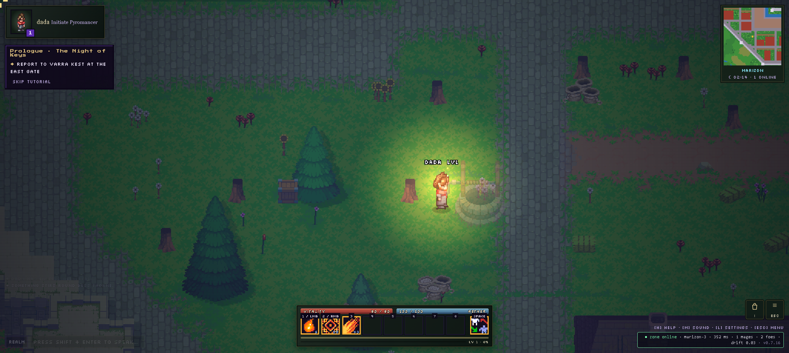

# AETHERFALL — offline mirror

Full mirror of **AETHERFALL** (https://aetherfall.dev/).

Source: https://aetherfall.dev/



> **Cover note (2026-10-13).** The image above is real gameplay captured from
> the **live origin** (`https://aetherfall.dev/`), not from this mirror: the
> pyromancer *dada* walking the night meadow of Marizon with the live HUD
> (VITALITY 90/90, AETHER 100/100, the fire-spell action bar, the "Prologue ·
> The Night of Keys" quest panel, the Marizon minimap and the zone status
> `zone online · marizon-3 · ms · 1 mages · 2 foes · drift 0.03 · v0.7.16`).
> The block is unchanged and re-confirmed on the mirror: served on loopback
> the client boots and renders its title screen, but its first gate call
> (`POST /v1/guest` on the AWS API) is refused — `403 "This page may not use
> the gate."` for `Origin: http://127.0.0.1:4325`, while the same request from
> `Origin: https://aetherfall.dev` is answered (`access-control-allow-origin:
> https://aetherfall.dev`) — and the realm backend (Convex + zone websocket)
> is not part of the capture either. The live origin's client is the same
> build captured here (`v0.7.16`); the cover is that run. The mirror's capture
> bytes are unaffected (`node tools/verify.mjs` → 71 files, 0 problems).
> Boot evidence from the mirror itself stays at `docs/boot-2026-10-12.png`.

## Stack

- **Vite production build at the origin root** — `index.html` + hashed `assets/*` chunks, no build step to serve
- **React 19.3.0** (`react` + `react-dom` + scheduler) bundled inside the entry chunk; **three.js r186** bundled inside the 3D renderer chunk, with a separate `GLTFLoader` addon chunk (DRACO / meshopt / KTX2 hooks)
- **two renderer chunks** — `assets/fx3d-*.js` (3D particle renderer, `createFx3D`) and `assets/hd2d-*.js` (2D/HD renderer, `createHd2d`), dynamic-imported by the client
- **Web Audio music** — four tracks fetched at runtime as `/audio/<name>.webm` with `.m4a` fallback
- **multiplayer client** — the bundle talks to an external AWS API gate and a zone websocket (see *External dependencies*); the mirror carries the client only

## What this is

AETHERFALL — "an epic pixel-art fantasy MMO RPG" (manifest.webmanifest), title screen *Chronicles of the Shattered Veil*, client version v0.7.16: a landscape-play pixel-art MMO with character creation (schools, elements, passives), an overworld (Marizon and beyond), quests, shops, loot and a 3D/HD-2D renderer switch, rendered by React + three.js from a Vite build. Captured whole from the origin root — entry document, four JS chunks, the stylesheet, every hashed sprite/art asset the bundle references, the parchment UI texture, both audio formats of all four tracks, favicon and web app manifest: **71 files, 16,423,492 bytes (~15.7 MiB)**, plus the runtime-built closure (dynamic imports, `__vite__mapDeps` tables, `/audio/…` names, CSS `url()` references) found by iterating the scan to a fixpoint.

**External dependencies (not captured, by design — CDN rule, socker precedent):** the AWS API gate `https://t5xbd6rn22.execute-api.sa-east-1.amazonaws.com` (guest auth, characters, `POST /v1/enter`, CORS-locked to the canonical origin), the Convex deployment the client syncs with (`docs.convex.dev` reference + Convex character plumbing inside the bundle), the zone websocket the gate hands out, Google Fonts (Press Start 2P / Silkscreen / Pixelify Sans / Atkinson Hyperlegible) and the Cloudflare Insights beacon. Without the backend the client renders and runs its title screen, but gameplay entry is refused.

**Capture gaps recorded honestly:** the deployment serves all **41 `.glb` model URLs as Git LFS pointer stubs** (131–132 bytes each — `version https://git-lfs.github.com/spec/v1 / oid sha256:… / size …`, `Content-Type: model/gltf-binary`); the real meshes were never deployed, so the mirror carries the stubs byte-exact as served. 136 unhashed logical asset keys extracted from the bundle (`assets/epic-0.png`, `assets/hall-storm.json`, `assets/marizon-cottage.glb`, …) are masked 404s: the origin's SPA fallback answers HTTP 200 with the entry HTML (the served artifacts are the hashed `/assets/…` files captured here, or objects inlined in the bundle) — they are recorded in `_mirror-report.json` under `unreachable` and in the scan, not silently dropped. Zero genuinely unreachable same-origin references remain.

## Layout

- `.upstream/manifest.json` — sha256 for every captured file (71 files)
- `readable/` — prettified derived layer (pinned prettier 3.9.6): the four minified
  chunks and the stylesheet (5 pretties, 233,892 lines), mirroring the served paths
  (`readable/assets/<chunk>.pretty.js|css`; since 2026-10-14, no `__` flattening)
- `src/` + `split-spec.json` — 339 statement-aligned slices of the app chunks with
  the recorded derivation spec (6 wholeFile sections, 3 skipped sections); slices
  live at their served paths under `src/assets/`
- `rename-map.json` + `tools/names.json` — the recorded semantic rename layer
  (campaign closed 2026-10-14): the reviewed list and the mechanically recovered
  map `tools/derive.mjs` re-applies on every re-cut
- `tools/derive.mjs` — rebuild `readable/` + `src/` + `split-spec.json` (re-applies
  the rename map; archives superseded derived files to `legacy/<date>/`)
- `tools/names.json` / `tools/apply-names.mjs` / `tools/recover-scoped-map.mjs` /
  `tools/verify-rename.mjs` / `tools/check-chunk.mjs` / `tools/refcheck.mjs` /
  `tools/engine/rename-layer.mjs` — the rename campaign writer, map recovery and
  reconstruction gates (pipeline: apply → recover → derive → gates)
- `tools/probe-structure.mjs` — read-only bundle-shape probe (the 2026-10-14
  structure decision evidence); `tools/lib-acorn.mjs` — authoring-time parser
  (installs into gitignored `tools/.deps/`)
- `tools/update.mjs` — read-only drift probe against the live site
- `tools/verify.mjs` — re-hash the capture against the manifest
- `tools/record-manifest.mjs` — re-walk/re-check the Gen-A manifest (canonical
  SKIP/NOT_CAPTURED sets; `--check` proves no derived path leaks)
- `tools/audit.js` — integrity gate for the derived layers (`AUDIT PASS`)
- `tools/check-links.mjs` — the export-binding link gate: does every export
  table the layer carries name a binding the layer declares? The engine
  (`node --input-type=module --check -`) is the judge. The three app chunks'
  export tables live in RECORDED TAILS (`split-spec.json` `sections[].text`),
  not in files on disk, and they are in the CAPTURE's spelling, so the gate
  rewrites them into the layer's spelling with the recorded rename map before
  it asks the engine. A table that names a binding a SIBLING slice declares
  is a FRAGMENT, not a defect.
- `tools/serve.mjs` — static server for the boot/serve probe (default port 4325)
- `legacy/2026-10-14/` — the superseded derived layers, byte-exact (proposal (o):
  the flattened 2026-10-12 `readable/` + `src/` and the pre-rename slices)
- `docs/cover.png` — the cover (real gameplay, shot from the live origin 2026-10-13)
- `docs/boot-2026-10-12.png` — boot evidence (title screen rendered by this mirror)
- `_mirror-report.json` — crawl record (probes, closure, unreachable, external)

## Assets

- **sprites / 2D art** — 13 file(s): `assets/` (epic-0…4, ground-0, mana-0/1, raven, srw, holloway — the NPC/enemy/world sprite atlases; scenery.model_crystal-altar, scenery.model_hollowed-crystal — the two scenery sprite sheets)
- **UI texture** — 1 file(s): `assets/` (parchment-vwolfdog — the parchment `url()` texture used by the stylesheet)
- **3D models (Git LFS pointer stubs, as served)** — 41 file(s): `assets/` (aether-crystal, castle-tower-*, hall-*, marizon-*, town-*, frost-pine, glowcap-mushrooms, … — 131–132 B LFS pointers; see *Capture gaps*)
- **audio** — 8 file(s): `audio/music/` (marizon_fight, marizon_idle, title_theme — each `.webm` + `.m4a`), `audio/ui/` (start_chime — `.webm` + `.m4a`)
- **code bundles** — 5 file(s): `assets/` (index-BTsv3a2s.js, fx3d-DiRK8ozf.js, hd2d-FOjpdF4f.js, GLTFLoader-MfgfXc7d.js, index-CrHozmsT.css) — captured verbatim, never edited
- **UI/icon + web app metadata** — 2 file(s): `favicon.svg`, `manifest.webmanifest` (root)
- **fonts** — none on disk — Google Fonts stay a CDN dependency (external)

## Run

```
npx serve .
```

Open the served root in a browser. The client boots and renders; entering the world
needs the live realm backend (see the *Cover note* / *External dependencies*). When
served from `localhost` the bundle allows a dev gate override — `?gate=https://…`
— and a zone override `?zone=off` / `?zone=<url>`, both by design of the shipped
client; neither substitutes for the missing backend.

## Boot test (2026-10-27)

- Entry: `http://127.0.0.1:4707/` served by `tools/serve.mjs` with the network blocked (`MAP * 127.0.0.1`).
- Outcome: **rendered** — the pixel-art title screen (*Chronicles of the Shattered Veil*, AETHERFALL, "PRESS ANY KEY", v0.7.16) renders over a live animated starfield; gameplay is still refused because the gate call is blocked.
- Evidence: body 100 chars; canvas 1263x570; 1 console error; 0 failed same-origin requests, 4 blocked cross-origin; screenshot `docs/boot-2026-10-27.png`.
- Gaps seen: none — all 23 same-origin boot requests answered 200; the 4 blocked cross-origin are Google Fonts, the Cloudflare Insights beacon, and the AWS gate `OPTIONS`/`POST /v1/guest` (expected under the offline rule).
- Hypothesis check: the README's "playable build absent/gated" claim is **refuted for "absent"** — the build is present and boots/renders offline from this mirror — and **confirmed for "gated"**: the boot's own `POST /v1/guest` is cross-origin and blocked. The title screen already posts to the live gate, so per the boot rule the run stopped at the menu rather than clicking through.

## Verify

```
node tools/verify.mjs                # re-hash the capture against the manifest
node tools/audit.js                  # derived-layer integrity gate (AUDIT PASS)
node tools/derive.mjs --check        # byte-compare a fresh re-cut (write nothing)
node tools/record-manifest.mjs --check  # manifest walk: no derived path leaks
node tools/verify-rename.mjs --all   # rename map reproduces + references/bindings
node tools/check-chunk.mjs --all     # cross-slice calls resolve after renames
node tools/check-exports.mjs         # public export names intact (3 tables checked, 1 vendor chunk honestly uncovered — see the 2026-10-27 note)
node tools/check-links.mjs           # every export table names a binding the layer declares (fragments are reported, breaks fail)
```

## Updating from upstream

```
node tools/update.mjs     # read-only drift probe: what changed upstream
```

The probe never rewrites the capture — a mirror is a point-in-time snapshot.
Notes for this origin: the entry is fetched with browser `Accept` headers (Cloudflare
only injects the Insights beacon into browser-shaped HTML requests — the capture was
taken that way) and the beacon tag is normalized on both sides; the origin has an SPA
fallback, so a 200 answer that is HTML on a non-HTML capture rel is reported as
`html-fallback (masked 404 upstream)`, never accepted. Refreshing means re-running the
fetch into a clean tree, re-cutting the derived layers on top of the new build
(`node tools/derive.mjs` — it re-applies the recorded rename map where the ranges
still align and archives superseded files to `legacy/<date>/`) and re-running the
rename pipeline (`apply → recover → derive → gates`) with the review list adapted
to the new build; a stale map fails loudly (derive/audit refuse), it never
mis-renames silently.

### 2026-10-31 refresh probe — real drift, refresh refused (derive plan is pinned to the old build)

The drift probe reports a genuine new deployment, and the refresh is **refused**
at the mirror's own derive step; the capture is untouched.

```
$ node tools/update.mjs
DRIFT: 1 changed, 5 live-missing, 0 html-fallback (of 71 captured)
  live-missing   assets/GLTFLoader-MfgfXc7d.js
  live-missing   assets/fx3d-DiRK8ozf.js
  live-missing   assets/hd2d-FOjpdF4f.js
  live-missing   assets/index-BTsv3a2s.js
  live-missing   assets/index-CrHozmsT.css
  changed        index.html
```

- **Classification: real content drift**, not Cloudflare token noise. The entry
  diff left, after the probe's own normalization of the rotating Insights tag
  (beacon `token` unchanged), is the build: `/assets/index-BTsv3a2s.js` →
  `/assets/index-DRRAfRbf.js` (2,945,491 → 3,217,370 B) and
  `/assets/index-CrHozmsT.css` → `/assets/index-G2agB6HL.css` (185,608 →
  194,185 B). The old hashed chunks are gone (normal for a Vite deploy, not a
  dead origin: the new ones answer 200). The other three chunks are rehashed —
  as served they differ from the capture **only** in the chunk-name references
  (`fx3d` 668,510 B, `GLTFLoader` 45,220 B: same length; `hd2d` 238,932 →
  238,930 B) — and React `19.3.0` / three.js `r186` (`revision: '186'`) are
  unchanged, so this is a rebuild of the same stack, not a stack change.
- **Trust gate: the fetch path is trusted.** All 65 still-served captured files
  re-hash byte-identical upstream; the 5 live-missing entries are exactly the
  superseded hashed names. Nothing on the origin has drifted in place.
- **Closure of the new build** (read-only scan of the new entry + chunks):
  80 hashed `/assets/…` references vs 60 in the capture — the same 13 sprite
  PNGs under unchanged hashes, **21 new project sprites** (17 `fx.lillith_*`
  and 4 `prop.*`), the same 41 `.glb` LFS pointer stubs under unchanged names,
  and the same four audio tracks (`marizon_fight`/`marizon_idle`/`title_theme`/
  `start_chime`). A refresh would be ~92 captured files.
- **Blocker — `tools/derive.mjs` refuses the new build** (measured in a
  throwaway copy under the gitignored `tmp/`, with the new chunks + a scratch
  manifest):

  ```
  $ node tools/derive.mjs
  derive: rename map: 41 word-boundary file(s), 5 indexed file(s)
  Error: assets/GLTFLoader-BSuq1M9G.js: no block plan recorded for this chunk — a new capture chunk needs a plan
  ```

  The derive plan addresses chunks **by served filename**
  (`assets/index-BTsv3a2s.js` → machinery head + React vendor region + app run,
  `assets/fx3d-DiRK8ozf.js` → bundled three.js region,
  `assets/hd2d-FOjpdF4f.js` → mapDeps head, `assets/GLTFLoader-MfgfXc7d.js` →
  whole-file vendor) and `tools/audit.js` re-checks those same names
  (`assets/index-BTsv3a2s-react-vendor.js`, …). The new hashes fall through to
  `planChunk`'s "no block plan recorded" branch. Writing the new capture first
  would leave `readable/`, `src/` and `split-spec.json` describing files the new
  build no longer serves, and every derived gate red (`derive --check`,
  `audit`, `verify-rename`, `check-chunk`, `check-links`).
- **Why it is not done here:** the fix is a tools change — the plan must
  discover chunk roles by content (entry = the chunk `index.html` loads; the
  renderer/addon chunks by their `__vite__mapDeps` role and vendor guards) — and
  then the 115-name / 883-splice rename campaign has to be re-run against the
  new slices (`apply → recover → derive → gates`). That is the recorded next
  lane, not a 10-minute pass. **No capture bytes were written**; `verify.mjs`
  still reports `71 files checked, 0 problems` and the boot evidence stays
  `docs/boot-2026-10-27.png`, both of which remain true because nothing in the
  capture changed.

### 2026-10-12 readable/src derivation

Both derived layers are in place, cut from the recorded capture (capture bytes
untouched — `node tools/verify.mjs` re-hashes all 71 files):

- `readable/` — pinned prettier 3.9.6 (module API, default options — never the CLI,
  it respects `.gitignore` and can silently echo its input) rendered the four
  minified chunks + the stylesheet to 5 pretties (233,892 lines total; capture-root
  names — the initial cut flattened the dirs with `__`, superseded 2026-10-14 by
  served-path mirroring, see the pass below). Every pretty is provably not a byte copy of its
  capture source. One nuance recorded in `split-spec.json`: prettier 3.9.6 needs a
  **second pass** on one member-chain region of the index chunk (pass 1 → pass 2
  differ, pass 2 is a fixed point), so derive and audit both iterate to the fixed
  point instead of claiming single-pass; audit re-renders all 5/5 pretties
  byte-exact under the pinned version (the 2026-10-14 pass keeps iterating — the
  index chunk records 3 format calls until the fixed point is confirmed).
- `src/` — 339 statement-aligned slices (`src/assets/<chunk>-NN.js` since the
  2026-10-14 pass, exact 2-line provenance
  header) recorded in `split-spec.json` (348 sections): 339/339 parse standalone
  (`node --input-type=module --check -`) and round-trip byte-exact to their readable
  line ranges (through the recorded rename map where renamed). Cuts land only on
  top-level declaration boundaries (~250–350 line
  windows); oversized single declarations stay whole (largest:
  `src/assets/index-BTsv3a2s-126.js`, 21,411 lines — the asset-URL map + a giant
  data-table declaration the minifier kept as one statement). Identifiers are the
  bundle's own minified names, except where the rename campaign (PLAN §5, closed
  2026-10-14 — see the pass below) replaced them with reviewed semantic names.
- Vendor rule — wholeFile sections, never sliced: the three.js `GLTFLoader` addon
  chunk (`assets/GLTFLoader-MfgfXc7d.js`, whole file) and the bundled three.js r186
  engine region inside `assets/fx3d-DiRK8ozf.js` (three.core/three.module up to and
  including the WebGLRenderer class; guarded by `WebGLRenderer`, `__THREE__ = '186'`
  and `revision: '186'`). The minifier merged the game's particle-shader table and
  element-palette tables into the same variable declaration as the WebGLRenderer
  class — declaration boundaries cannot cut inside it, so the wholeFile region
  carries them and the app resumes at the guarded palette color helper.
- Vendor region in the entry chunk — wholeFile, never sliced: the React 19.3.0
  bundle (react + react-dom + scheduler as CJS modules under the rollup require
  helper, one declaration), guarded by `react.dev/errors`, `Minified React error`,
  `react.transitional.element`, `createRoot`, version `19.3.0` and the DevTools
  hook; the app resumes at the guarded class-table head.
- Machinery rule — wholeFile: the `__vite__mapDeps` table + rollup CJS interop
  helpers + Vite modulepreload polyfill opening the index chunk, and the
  `__vite__mapDeps` table opening the hd2d chunk. Stylesheet rule —
  `assets/index-CrHozmsT.css` is wholeFile. Non-standalone parts are skipped
  sections (3): every app chunk's final `export {…}` table (the bindings live in the
  earlier slices).
- Inline scan — `index.html` has zero inline `<script>`/`<style>` content blocks
  (two external scripts: the entry chunk and the CF beacon), so there are no
  `*-inline-N` twins and no `index-inline-map.json`.
- Gates: `node tools/verify.mjs` → `71 files checked, 0 problems`;
  `node tools/update.mjs` → `up to date: 71 captured files identical upstream`;
  `node tools/audit.js` → `AUDIT PASS` (339/339 round-trips, 5/5 pretties re-render
  byte-exact, 348 sections, 6/6 imports resolve); serve probe — entry, the entry JS,
  the stylesheet, the fx3d chunk and an audio track over HTTP 200, listener killed,
  port closed (netstat + refused connection). Rebuild with `node tools/derive.mjs`.
- Boot test (opencli, default profile; mirror served on loopback with `npx serve`):
  the title screen renders — pixel-art scene, animated particles, zero console
  messages — screenshot `docs/boot-2026-10-12.png`. A full browser network log
  cross-checks the closure: 23 same-origin requests during boot (entry, entry
  JS/CSS, favicon, webmanifest, 12 sprite/art assets, 4 audio `.webm`), every one
  present in `.upstream/manifest.json`; the only same-origin miss is the Cloudflare
  Insights beacon's `/cdn-cgi/rum` telemetry (a static mirror has no CF edge —
  404, `cdn-cgi` class, never captured, probe-neutral). **Actual gameplay could not
  be reached from the mirror origin**: the client's first gate call
  (`POST /v1/guest` on the AWS API) fails CORS (`403 This page may not use the gate.`
  — the API's `access-control-allow-origin` is `https://aetherfall.dev` only), and
  the bundle's only localhost affordances (`?gate=`/`?zone=`) still require a realm
  server (Convex + zone websocket) that is not part of the capture. The cover was
  therefore shot from the live origin (see the cover note at the top); the mirror
  itself never reaches gameplay.
- §0.4 fork-over-mirror checked 2026-10-12: the page and every captured JS/CSS/HTML
  file reference **no public source repo** (no github.com/gitlab/bitbucket/source-repo
  strings anywhere; the only absolute links are docs.convex.dev, react.dev error
  docs, fonts, the Cloudflare beacon and the deployed AWS endpoint), so there is
  nothing to fork and the mirror stands.

### 2026-10-14 structure + rename pass (served paths; campaign closed)

**Structure decided from BYTES** (`tools/probe-structure.mjs`, read-only): real
`import`/`export` specifiers (fx3d imports its shared bindings from
`./index-BTsv3a2s.js`; the runtime dynamic-imports fx3d/hd2d through the entry's
`__vite__mapDeps` table), **0** module-factory signatures (no
`__webpack_require__`/Turbopack), **0** `sourceMappingURL` and **0** `*.map`
files — flat Vite production ES modules, so statement-aligned slices stay the
true boundary (the taipei-rush-tokyo / clawd-rpg flat-ESM precedent; the
factory-family split is inapplicable). The capture preserves the served URL
structure (`index.html`, `assets/`, `audio/` at the root), so the derived layers
now **mirror the served paths** (PLAN §5 served-path paragraph):
`readable/assets/<chunk>.pretty.js|css` and `src/assets/<chunk>-NN.js` — no more
`__` flattening. The vendor/machinery bands stay wholeFile exactly as recorded
(entry chunk-machinery head + React 19.3.0 region, fx3d three.js r186 region,
hd2d mapDeps head, the whole GLTFLoader addon chunk, the stylesheet); the three
final `export {…}` tables stay skipped sections, reached through the recorded
`renameBindings`.

**Superseded layers archived** (proposal (o), both layers, byte-exact):
`legacy/2026-10-14/readable/` + `legacy/2026-10-14/src/` carry the flattened
2026-10-12 cut (344 files) plus the 8 pre-rename slices whose provenance-marker
word changed when derive recomputed it on the renamed body. Nothing was
dropped; the capture bytes are untouched.

**Rename campaign (the previously-open PLAN §5 task) — CLOSED.** No upstream
maps exist (0 `sourceMappingURL` / 0 `*.map`), so every name is evidence-based.
The campaign's priority was the multiplayer client's gate/realm layer, named so
the code reflects the captured reality — the live backend is **external** (the
AWS API gate, the Convex deployment, the zone websocket) and the mirror carries
only the client: `GateClient`/`GateError`/`gateBaseUrl` (the `?gate=` override
falling back to the deployed AWS endpoint), `ZoneClient`/`ZoneError`/
`normalizeZoneUrl`/`fetchDevTicket` (the `/v1/rooms/<room>/ws` socket, the
`?zone=`/`?room=` overrides, the `/dev/ticket` dev seat), the device-token
identity (`deviceToken`/`rotateDeviceToken`/`DEVICE_TOKEN_KEY`), the realm
session store (`realmSession`/`setSession`/`useRealmSession`/
`connectGateSession`/`refreshRoster`/`enterCharacter`/`realmRequest`/
`activeZone`), the record mappers (`hydratePlayer`/`toOwnedItem`/`withAffixes`/
`toInventoryView`/`mergeChatLines`/`altarRiteEvents`) and the backend adapters
(`awsBackend`/`convexBackend`/`activeBackend` + the `aws*Unsupported` stubs that
name the AWS-realm limitations verbatim). The renderer chunks got their cores:
`createFx3D`/`createHd2d` (renamed to the chunks' own export names — the export
tables are reached via `renameBindings`, turfwar's (t)(1)), `Fx3dLayer`/`FxKit`/
`GolemFx`/`MageFx`, `Hd2dRenderer`/`TextureAtlas`/`packAtlas`, the
element-palette layer (`parseHexColor`/`paletteColor`/`buildPaletteTexture`/
`ELEMENT_COLORS`/`elementColor`), the quality caps and hd2d plumbing
(`QUALITY_TIERS`/`MAX_POINT_LIGHTS`/`MAX_LINE_LIGHTS`/`ATLAS_SIZE`/`QUAD_VERTS`/
`SHARPEN_GLSL`/`HD_SPACE`, …) and the math helpers (`rand`/`clamp01`/
`smoothstep`/`TAU`/`WORLD_SCALE`/`PIXELS_PER_UNIT`/`lightFalloff`). Totals:
**115 reviewed names / 883 identifier splices over 41 slices** (221
word-boundary rename records + 7 indexed names over 55 occurrences; the
recovered `rename-map.json` is re-applied by `tools/derive.mjs` on every
re-cut). **Vendor rule** — the wholeFile bands and the minifier-merged bundled
**Convex client region** inside the entry chunk (~lines 104993-105775 of the
pretty: the codec/react-client incl. `ConvexError` and its generated-api
machinery) are third-party bytes and were **never renamed**. Remaining below
the review frontier: ~4,050 eligible program-scope names in the entry chunk
(its mapDeps'd vendor-adjacent machinery and the bulk of the game code), ~470
in hd2d, ~86 in fx3d — kept minified, annotated as the next sub-task (the
fleet precedent). A capture refresh will need the campaign re-authored against
the new build (derive re-applies the map only while the ranges align).

Gate tails, verbatim (2026-10-14):

```
node tools/verify.mjs
71 files checked, 0 problems
```
```
node tools/audit.js
AUDIT PASS — 348 spec sections (339/339 src↔pretty round-trips byte-exact, 41 through the recorded rename map, 5/5 pretty sources tiled contiguously, 3/3 skipped loader/merged/export sections re-verified textually, 339/339 src slices + 4/4 readable/*.pretty.js parse standalone (node --input-type=module --check -), 5/5 pretties provably distinct from their capture source, 5/5 sources provenanced, 9 index-only wholeFile/skipped sections carry no src file, 0 inline content block(s) (twins + index-inline-map.json cross-checked), 3/3 imports resolve inside the capture (0 whitelisted machinery), 4/4 renameBindings name(s) re-found in skipped sections + binding map applies, 5/5 pretties re-render byte-exact under pinned prettier 3.9.6 (fixed point), capture manifest free of derived layers)
```
```
node tools/derive.mjs --check
derive: 5 readable file(s), 339 src slices (339/339 parse standalone, 339/339 round-trip byte-exact), 3 skipped, 5 wholeFile, 4 pretty js parse clean, 0 orphan(s) pruned — self-check clean [--check: write nothing]
```
```
node tools/apply-names.mjs --all --dry
apply-names: 339 file(s) visited, 0 changed, 0 rule group(s), 883 identifier splice(s) (app: 115 name(s) over 3 chunk(s), 883 splice(s)) (dry run)
```
```
node tools/recover-scoped-map.mjs
recover: 339 slice(s) aligned (1,655,766 identifier/token positions), 41 renamed slice(s) — 221 word-boundary record(s), 7 indexed name(s) over 55 occurrence(s)
```
```
node tools/verify-rename.mjs --all
verify-rename: 339/339 slice(s) reproduce byte-exact, 41 renamed slice(s) (55 indexed occurrence(s)), 3/3 chunk(s) references+bindings YES
```
```
node tools/check-chunk.mjs --all
check-chunk: 3 chunk(s), 339 slice body(ies) substituted — all cross-slice calls resolve
```
```
node tools/record-manifest.mjs --check
record-manifest --check: PASS — 71 capture file(s) recorded, walk agrees byte-for-byte, no derived path leaked
```
```
serve probe (tools/serve.mjs on 4325)
9/9 byte-identical over HTTP, 404 OK        (port 4325 closed after the probe)
```

**Honest gaps (2026-10-14).** The backend reality is unchanged: the guest gate
is CORS-locked to `https://aetherfall.dev` (verified 403 from loopback) and the
realm (Convex + zone websocket) is not part of the capture, so actual gameplay
still cannot be reached from the mirror origin — the cover remains the live
run, boot evidence stays `docs/boot-2026-10-12.png`, and the only boot probe
here is HTTP-level (serve byte-compare + port close). The rename frontier above
is the recorded next sub-task; renames never touch the capture bytes
(`verify.mjs` re-hashes all 71 files after every pass).

### 2026-10-27 export-name coverage note (the one table the gate cannot reach)

`node tools/check-exports.mjs` measures this mirror's public export surface against
the derived layer. Verbatim (2026-10-27):

```
check-exports: 3 export table(s) checked
check-exports: 1 export table(s) NOT covered (no derived text) — these are unchecked, not proven intact
  readable/assets/GLTFLoader-MfgfXc7d.pretty.js: 1
check-exports: no public export name lost
```

The capture carries exactly four export tables, one per JS chunk
(`assets/index-BTsv3a2s.js`, `assets/fx3d-DiRK8ozf.js`, `assets/hd2d-FOjpdF4f.js`,
`assets/GLTFLoader-MfgfXc7d.js`). Three are `checked`: each app chunk's final
`export {…}` table is recorded as a skipped tail (`sections[].text` = the served
chunk's own statement) and compared against the reading copy's table.

The fourth — the GLTFLoader addon chunk's `export { ke as GLTFLoader }` — is the one
the gate reports as NOT covered. **It is load-bearing:** the hd2d chunk names it as
entry 0 of its `__vite__mapDeps` table (`"assets/GLTFLoader-MfgfXc7d.js"`, pretty
line 6) and dynamic-imports it for the export (``await import(`./GLTFLoader-MfgfXc7d.js`)``
bar `return { GLTFLoader: e }`, pretty lines 2429-2430); the entry chunk's own
`__vite__mapDeps` table lists only hd2d and fx3d, so hd2d is the importer —
`GLTFLoader` is public, not dead weight.

**Why the gate cannot reach it.** The vendor rule carries this third-party chunk
whole in `readable/` and never slices it, so `src/` has no text for the chunk and
`split-spec.json` records the section as an index-only `wholeFile` section. The gate
walks the readable pretty (its `sourceFile`) and finds the table, but the only
derived text available for it would be the pretty itself — a self-compare, which the
gate refuses to count. The mirror's own link gate records the same fact:
`check-links` lists `readable/assets/GLTFLoader-MfgfXc7d.pretty.js` under
"scopes indexed but not carried by the layer (the capture's own table, not the
layer's)" and exits green.

The recorded provenance `assets/GLTFLoader-MfgfXc7d.js ->
readable/assets/GLTFLoader-MfgfXc7d.pretty.js` exists in `sources[]`, and an export
tail in the shape the other three chunks already use makes the gate compare the
served statement with the reading copy's table: proven in a throwaway copy to move
`checked` 3 → 4 and NOT covered 1 → 0, and to go RED naming the chunk when the
reading copy's table is mutated. It is **not committed here**: `split-spec.json` is
generated by `tools/derive.mjs` and `node tools/derive.mjs --check` pins it
byte-exact (`split-spec.json is stale (re-derive with: node tools/derive.mjs)`), so
the tail must be emitted by the generator, not hand-written into the spec. Recorded
as the next sub-task for the tools lane; until then the uncovered count is honest.

## Mirror conventions

- **Capture layer** — the captured files are byte-exact copies of what the
  origin served; nothing in them is edited (including the 132-byte LFS stubs).
- **Readable layer** — `readable/` is derived (prettified) and never shipped to a
  browser; it exists so the bundle can actually be read, and it keeps the served
  paths (`readable/assets/…`). It stays pristine: only `src/` carries the reviewed
  semantic names of the rename campaign (`tools/names.json`), and
  `rename-map.json` is the mechanically recovered record every re-cut re-applies.
- **Provenance** — `.upstream/manifest.json` records sha256 for each captured
  artifact, and `tools/verify.mjs` re-checks it.
- **Drift** — `tools/update.mjs` is read-only: it reports what changed upstream
  and never rewrites the capture.

## Fleet status

<!-- mirror-status:start — feeds _standard/REPO-INDEX.md. Update ONLY your own mirror's block; never edit the shared index (PLAN §8). Rebuild: node _standard/build-index.mjs -->
<!-- cols: cls=classification · ver=verify 0 problems · upd=drift probe · man=manifest · rdbl=readable re-derived · src=reversed src · boot=boot test · top=offline-mirror topic · tag=backup tag · staged=staged not committed -->
| # | repo | cls | ver | upd | man | rdbl | src | boot | top | tag | staged |
|---|---|---|---|---|---|---|---|---|---|---|---|
| 289 | aetherfall | mirror | ✓ | ✓ | ✓ | ✓ | ✓ | ✓ | ✓ | — | — |
<!-- mirror-status:end -->


## Snapshot policy (2026-10-31)

Frozen point-in-time snapshot - deliberate, fleet decision 2026-10-31. New Vite build; tools/derive.mjs plans chunks by served filename and tools/audit.js re-checks those same names, so a refresh needs role discovery by content plus a re-run of the 115-name rename campaign. The capture stays byte-exact and boots offline; a refresh needs a full re-capture/re-derive campaign (a new mirror, not a refresh), so the mirror is declared frozen rather than left looking stale. Re-review if the origin serves the old build again.
